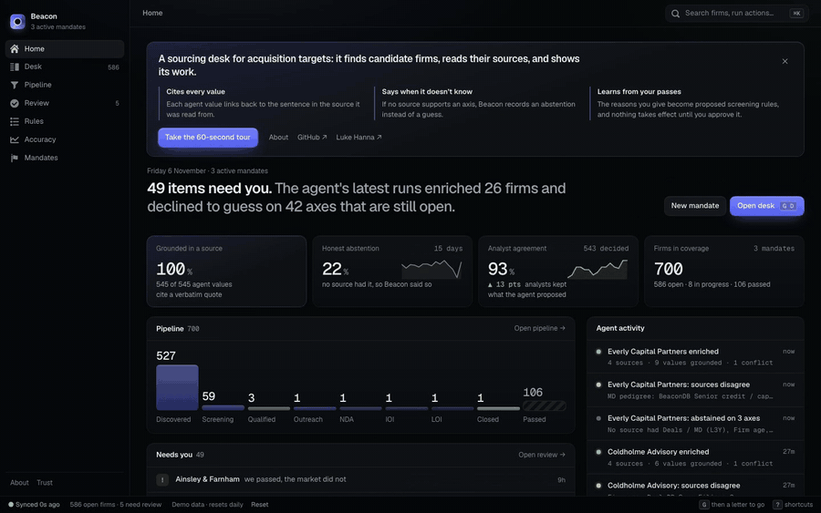
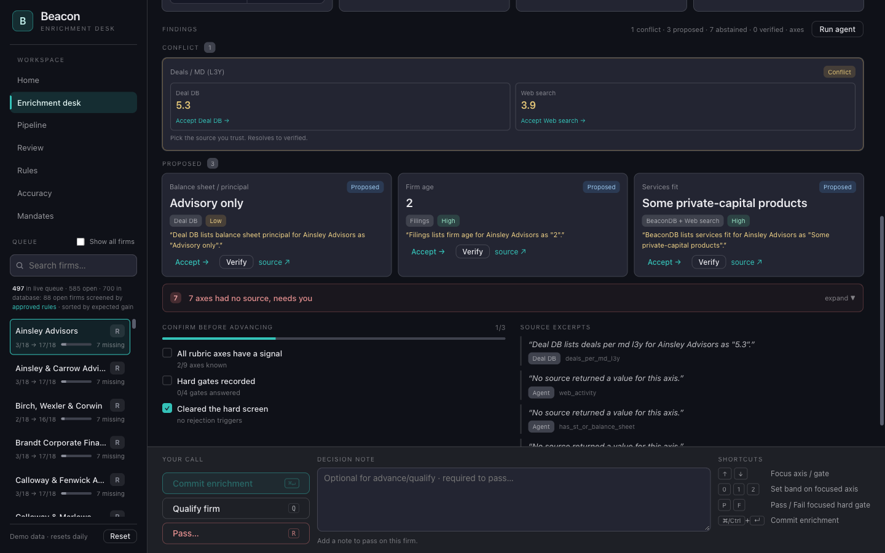
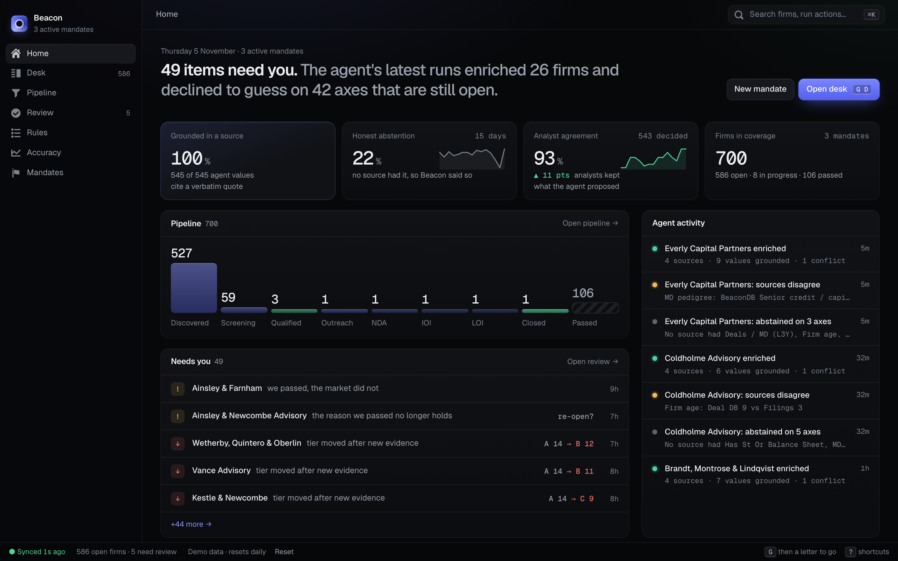
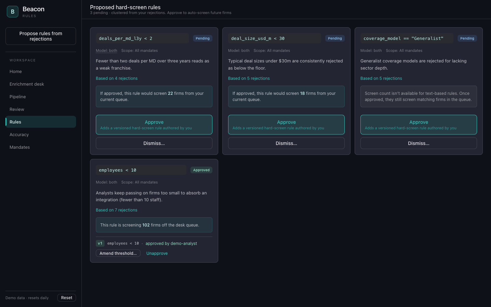
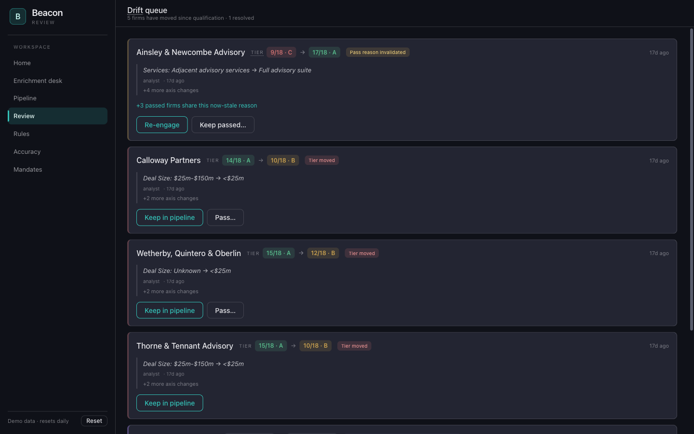
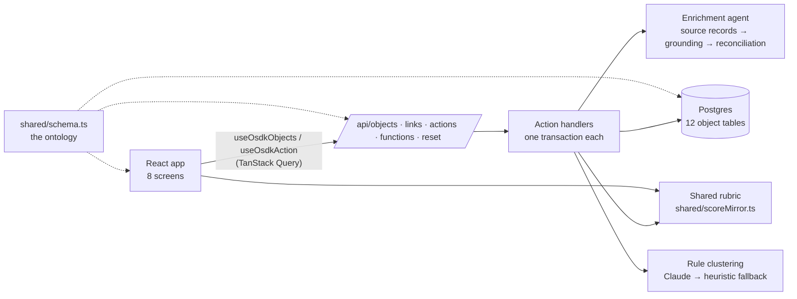

# Beacon

[](https://github.com/llukehanna/beacon/actions/workflows/ci.yml)

Acquisition-target sourcing for a corporate development team. Analysts turn a mandate into a searched universe of advisory firms. An agent assembles cited evidence for each firm, a deterministic rubric scores and tiers every firm, and the reasons analysts pass on firms become proposed screening rules for the next search.

**Live demo:** https://beacon.lukeghanna.com (synthetic data, resets daily)

[](docs/media/golden-path.mp4)

Full-quality video: [golden-path.mp4](docs/media/golden-path.mp4).



## What it does

- **Mandate → search.** Scope a candidate universe by thesis (corporate finance or capital solutions), geography, product, and sector.
- **Grounded agent enrichment with honest abstention.** Claude reads four mock source records per firm and returns each value with the exact sentence that supports it. A value is kept only if that quote appears word for word in the record and contains the value. Agreement becomes one corroborated finding, disagreement becomes an explicit conflict for the analyst, and an axis no source supports is recorded as an abstention instead of a guess. Every cited value opens its source record with the quote highlighted.
- **Deterministic scoring.** An 18-point, nine-axis rubric per thesis, with hard rejects and A/B/C tiers. The same code runs in the browser for live previews and on the server for the record.
- **Append-only audit trail.** Scores, findings, and decisions are versioned, never edited.
- **A learning loop with a human in it.** Pass rationales are clustered (by Claude, with a deterministic fallback) into proposed screening rules. Each proposal is checked against the data, shows how many firms it would screen, and only takes effect after an analyst approves it.
- **Drift.** When new evidence moves a qualified or passed firm's tier, or a passed firm is bought by a competitor, it resurfaces for review.

| Home                               | Rules                                         | Review                                       |
| ---------------------------------- | --------------------------------------------- | -------------------------------------------- |
|  |  |  |

## More

- [Development history](docs/development-history.md): how the project got here, with dates.
- [Production roadmap](docs/production-roadmap.md): what a production deployment would need that the demo does not have.

## Architecture

See [docs/architecture.md](docs/architecture.md).



## Built on Palantir Foundry, then ported

Beacon was first built on Palantir Foundry (Ontology, Functions, Actions, AIP, OSDK). When that environment went away, the backend was rebuilt on an open stack behind the same frontend. [docs/foundry-origins.md](docs/foundry-origins.md) maps each Foundry concept to its replacement.

## Run it locally

Requires Node 22+.

```bash
npm install
npm run seed      # builds the demo world and its reset snapshot in .data/pglite (in-process Postgres)
npm run dev       # http://localhost:8080
```

`npm run check` runs the sanitization guard, lint, the formatting check, both typechecks, and the test suite.

Rule clustering uses a keyword heuristic by default. To use Claude, set `CLAUDE_CLUSTERING=on` and provide Anthropic credentials (`ANTHROPIC_API_KEY`). The public demo allows at most one Claude call per 10 minutes and 24 per day; everything else falls back to the heuristic.

## Deploy

**Extraction.** `npm run extract` has Claude (Haiku 4.5, Message Batches API) read every firm's four source records and writes the answers to `fixtures/extraction/*.jsonl`, with model, prompt version, document hash, tokens, and cost per firm. `--max-usd` (default 5) stops the run before the cap would be passed, planned against worst-case output. A rerun skips firms that already have a current record, and `--resume-batch <id>` collects a batch that was already paid for. The "Extract" GitHub Actions workflow runs the same command with the key from a repository secret and pushes the fixtures to a branch. The seed, the demo, and CI only read the committed fixtures, so they need no key. A firm with no current fixture falls back to a rule-based extractor that produces the same shape.

Beacon runs on Cloudflare Workers (free plan): the Vite build is served as static assets with an SPA fallback, and `/api/*` runs in `worker/index.ts`. Smart Placement runs the Worker near the database, and `POST /api/actions` (60 per minute) and `POST /api/reset` (3 per minute) are rate limited per client IP.

**Production** (`beacon.lukeghanna.com`) reads one Worker secret: `DATABASE_URL` (Neon Postgres).

```bash
npx wrangler secret put DATABASE_URL
DATABASE_URL='<neon connection string>' npm run seed   # once, and after schema or seed changes
npm run deploy    # typecheck, vite build, wrangler deploy
```

**Hyperdrive (optional).** To pool and cache connections in front of Neon, create the config once, then uncomment the `hyperdrive` block in `wrangler.jsonc` and paste the id. The Worker uses the binding when present and falls back to `DATABASE_URL` otherwise.

```bash
npx wrangler hyperdrive create beacon-db --connection-string='<neon connection string>'
```

**Presenter environment.** A second deployment, `beacon-presenter`, serves the same build on a `workers.dev` URL with its own database and the same nightly reset, so it can be edited live without touching production.

```bash
# 1. Create a Neon branch for it and copy its connection string.
npx wrangler secret put DATABASE_URL --env presenter
DATABASE_URL='<presenter branch connection string>' npm run seed
npm run deploy:presenter
# 2. In Cloudflare Zero Trust, add an Access application on the beacon-presenter workers.dev route.
```

**Reseeding.** The "Reseed" GitHub Actions workflow (manual dispatch, target `production` or `presenter`) runs `npm run seed` against the matching database secret (`DATABASE_URL_PRODUCTION` or `DATABASE_URL_PRESENTER`). Run it after schema or seed changes.

`npm run seed` builds the demo through the real actions and saves it as `snapshot_*` tables. The Reset button and the nightly Cron Trigger restore that snapshot in one transaction, with timestamps moved forward to the moment of the reset, which keeps a reset within the Workers free plan's CPU budget.

## Project layout

| Path                 | What lives there                                                                                      |
| -------------------- | ----------------------------------------------------------------------------------------------------- |
| `shared/`            | The ontology schema, rubric, vocabulary, taxonomy, predicates (used by both sides)                    |
| `server/actions/`    | One module per domain; every write is a named, validated, transactional action                        |
| `server/enrichment/` | Deterministic mock providers and evidence reconciliation                                              |
| `server/extraction/` | Mock source records, the extraction prompt contract, the grounding check, fixtures, and the spend cap |
| `server/clustering/` | Claude and heuristic rule proposers                                                                   |
| `server/seed/`       | 700-firm synthetic universe and a history built by the real actions                                   |
| `api/`               | Thin HTTP adapters (`Request` → `Response`)                                                           |
| `worker/`            | Cloudflare Worker: serves the built app, routes `/api/*`, runs the nightly reset                      |
| `src/`               | The React app; `src/data/` is the typed data layer                                                    |

## Data

Everything is synthetic. Firm names are generated from invented words, and any resemblance to a real firm is coincidental. Enrichment sources are generated records, labelled "Mock source" in the app, and some contain deliberate errors.
