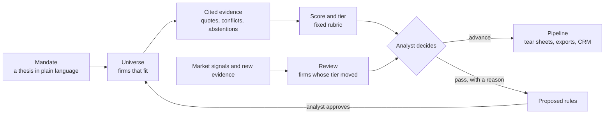

# Beacon

[](https://github.com/llukehanna/beacon/actions/workflows/ci.yml)
[](docs/evals.md)
[](LICENSE)

**An AI-assisted workbench for sourcing acquisition targets: every value it shows carries its source, and analysts' decisions become the screening rules for the next search.**

Built as a Palantir Foundry project, then ported to an open stack (Postgres, TypeScript, Cloudflare Workers) behind the same frontend.

**[Try it](https://beacon.lukeghanna.com)** (synthetic data, resets daily) · **[Take the 60-second tour](https://beacon.lukeghanna.com/?tour=1)** · **[Read the case study](docs/foundry-origins.md)**

[](docs/media/golden-path.mp4)

## The problem

A corporate development team buying advisory firms starts from a thesis ("sector-focused sell-side boutiques in North America") and ends with a short list it can defend. In between, analysts pull a universe from several databases, find that the sources disagree, fill the gaps by hand, score each firm against the thesis, and pass on most of them. The reasons they pass are written down once and never used again, so the next search makes the same mistakes. And an AI that fills gaps by guessing makes the list harder to defend, not easier.

## What it does

- **From thesis to universe.** A mandate written in plain language is read back as filters (thesis, geography, product, sector), and the search returns the firms that fit.
- **Evidence you can check.** An agent reads each firm's source records and proposes a value for every scoring axis, with the sentence that supports it. A value without a word-for-word quote is thrown away. When sources disagree the analyst sees both sides; when no source has the answer the agent says so rather than guessing.
- **A score anyone can explain.** A fixed 18-point rubric per thesis gives every firm a score and an A/B/C tier, with hard rejects. The same rubric previews in the browser and records on the server.
- **Decisions that teach the next search.** The reasons analysts pass on firms are grouped into proposed screening rules, each showing how many firms it would screen out. A rule applies only after an analyst approves it.
- **Nothing goes stale quietly.** When new evidence or a market event (a senior hire, a departure, an acquisition) moves a firm's tier, it comes back for review.
- **Work that leaves the tool.** Excel workbooks with a citations sheet, CSVs in Salesforce, DealCloud and Affinity layouts, a printable one-page tear sheet per firm, and lookalike targets with the reasons they match.
- **Built for a regulated desk.** A demo of information barriers: a restricted list hidden from everyone but compliance, codenames for mandates a viewer is not cleared for, and an access log. Every score, finding and decision is kept as history, never edited.
- **Open to other agents.** A read-only [MCP server](docs/mcp.md) lets an AI assistant search firms, read a firm's cited evidence and list screening rules, under the same barriers.



| Home                               | Rules                                         | Review                                       |
| ---------------------------------- | --------------------------------------------- | -------------------------------------------- |
|  |  |  |

## By the numbers

Every figure is measured against the synthetic universe's hidden truth; none says how the agent would do on real firms. [evals.md](docs/evals.md) has the full run, regenerated by `npm run eval` and checked in CI.

|                                                                   |                                                                       |
| ----------------------------------------------------------------- | --------------------------------------------------------------------- |
| Synthetic firms, each with four mock source records               | 700                                                                   |
| Values Claude Haiku 4.5 extracted that passed the grounding check | 6,455 of 6,472 (99.7%)                                                |
| Settled values that match the truth                               | 93.2%, on 68.3% of axes                                               |
| Conflicts where the more trusted source was right                 | 90.8%                                                                 |
| Abstentions where no source had the value                         | 100%                                                                  |
| Planted rejection patterns the clusterer recovers, in the evaluation | 4 of 4 (the app does not keep a proposal that repeats a rubric gate) |
| Cost of the recorded extraction run, all 700 firms                | $1.39                                                                 |
| Ontology                                                          | 18 object tables, every write a named action in one transaction       |
| Tests                                                             | over 1,200 unit and integration tests and 176 end-to-end tests, in CI, plus a daily check of the live demo |

## Why it is built this way

Ten short [decision records](docs/decisions/README.md) explain the choices that matter, among them:

- [Abstention over guessing](docs/decisions/0004-abstention-over-guessing.md): an empty cell is more useful to an analyst than a confident wrong one.
- [Claude extraction with a grounding check and recorded fixtures](docs/decisions/0002-claude-extraction-grounding-fixtures.md): every value quotes its source, and the demo, seed and CI need no API key.
- [Human approval before rules apply](docs/decisions/0007-human-approval-before-rules-apply.md): the system proposes, an analyst decides.
- [One rubric module on both sides](docs/decisions/0003-shared-rubric-module.md): the score previewed is the score recorded.
- [Workers and a snapshot reset](docs/decisions/0008-workers-and-snapshot-reset.md): a public demo that runs on a free plan and resets in one transaction.
- [An OSDK-shaped data seam](docs/decisions/0001-osdk-shaped-data-seam.md): the frontend can move back to Foundry without changing its screens.

## More

- [Architecture](docs/architecture.md): the code-level design, data flow and API.
- [Case study: Foundry to an open stack](docs/foundry-origins.md): what each Foundry concept became, and what was lost or gained.
- [Error analysis](docs/error-analysis.md): where the agent goes wrong, and what Beacon does about each kind of failure.
- [Security](docs/security.md): what the demo enforces and what it does not, each claim tied to the file it comes from.
- [Ontology reference](docs/ontology.md): every object type, link and action, generated from the schema.
- [MCP server](docs/mcp.md): tools, schemas and client configuration.
- [Deploying](docs/deploy.md): extraction, Cloudflare Workers, Neon, the presenter environment and reseeding.
- [Development history](docs/development-history.md) and [production roadmap](docs/production-roadmap.md).

## Run it locally

Requires Node 22+.

```bash
npm install
npm run seed      # builds the demo world and its reset snapshot in .data/pglite (in-process Postgres)
npm run dev       # http://localhost:8080
```

`npm run check` runs the sanitization guard, lint, the formatting check, both typechecks and the test suite. `npm run e2e` runs the Playwright suite, `npm run eval` the evaluation, and `npm run ontology:doc` regenerates the ontology reference (CI fails if it is out of date).

Rule clustering uses a keyword heuristic by default. To use Claude, set `CLAUDE_CLUSTERING=on` and provide `ANTHROPIC_API_KEY`. The public demo allows at most one Claude call per 10 minutes and 24 per day; everything else falls back to the heuristic.

## Project layout

| Path                 | What lives there                                                                                      |
| -------------------- | ----------------------------------------------------------------------------------------------------- |
| `shared/`            | The ontology schema, rubric, access policy, exports, lookalikes and vocabulary (used by both sides)   |
| `server/actions/`    | One module per domain; every write is a named, validated, transactional action                        |
| `server/enrichment/` | Deterministic mock providers and evidence reconciliation                                              |
| `server/extraction/` | Mock source records, the extraction prompt contract, the grounding check, fixtures, and the spend cap |
| `server/clustering/` | Claude and heuristic rule proposers                                                                   |
| `server/signals/`    | Synthetic market signals: the pure planner and the scheduled run                                      |
| `server/mcp/`        | The read-only MCP server's tools                                                                      |
| `server/seed/`       | 700-firm synthetic universe and a history built by the real actions                                   |
| `api/`               | Thin HTTP adapters (`Request` → `Response`)                                                           |
| `worker/`            | Cloudflare Worker: serves the built app, routes `/api/*`, runs the nightly reset and hourly signals   |
| `src/`               | The React app; `src/data/` is the typed data layer                                                    |

## Data

Everything is synthetic. Firm names are generated from invented words, and any resemblance to a real firm is coincidental. Enrichment sources are generated records, labelled "Mock source" in the app, and some contain deliberate errors. Market signals are invented news and are labelled "Synthetic market signal" wherever they appear.
