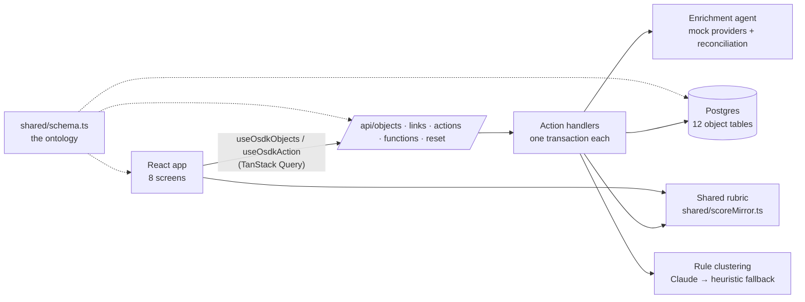

# Architecture

Beacon is a React app over a small TypeScript backend. One schema file describes the whole data model, every write goes through a named action, and the rubric is one module that both the browser and the server import.



## Ontology first

`shared/schema.ts` declares the 12 object types (firms, mandates, searches, findings, model extractions, scores, decisions, drift events, rules, hard-screen configs, and the search join objects), their properties and types, the two links the UI traverses, and the 18 action names. Everything else derives from it:

- **Storage.** `server/db/ddl.ts` generates one Postgres table per object type, with quoted camelCase columns that match the property names. `ensureSchema` runs it on every cold start and then adds any property column an existing table lacks, so a new property reaches a database created before it. It reads `information_schema` first and runs `ALTER TABLE` (under a 5 s lock timeout) only for columns actually missing, so a current database is never locked; a saved demo snapshot taken earlier restores the new column empty until the next `npm run seed`.
- **Repository.** `server/db/repo.ts` reads and writes by object type. Every column name that reaches SQL is checked against the schema first, and every value is a bound parameter, so a request can't name a column that doesn't exist or inject SQL.
- **API.** `GET /api/objects` lists one type with `$eq` filters and ordering, a page at a time (`pageSize` up to 1000 and an opaque `pageToken`). `POST /api/links` follows a link for many source objects in one query, `POST /api/actions` applies a named action and reports which object types it wrote, and `GET /api/functions` runs a named, read-only query function so the browser receives numbers or a small result instead of rows:
  - `homeSummary`: everything Home shows (inbox, funnel, trust figures, trends, mandates, agent activity), aggregated in SQL and the shared rules.
  - `accuracySummary`: the Accuracy page's tables (agreement and abstention by source and by axis) and the outcomes of the firms behind them.
  - `sourceDocument`: the source document one provider holds for one firm, rendered on demand for the source drawer.
  - `firmObservations`: what each provider said about each axis of a firm, and whether its quote held up against its document.
  - `shellCounts`: the open-firm, review and active-mandate counts the sidebar and status bar show on every route, counted in SQL so no screen pays for the full Home summary.
- **Frontend.** `src/data/hooks.ts` exposes typed hooks keyed by the same type names. They keep the OSDK hook names the pages were written against, so the screens didn't change when the backend did. `useOsdkQuery` calls a query function, and a successful action refreshes only the object types it wrote, the links that touch them, and the function results.

Locally the database is PGlite (Postgres compiled to WebAssembly, persisted under `.data/`). In production it is Neon Postgres. The same SQL runs on both.

## Actions

Every write is an action in `server/actions/`, registered by name. Applying one:

1. Checks the demo's ceilings (activity tables, mandates, searches) so a single visitor can't fill the shared database.
2. Validates the parameters against the action's spec: types, lengths, list sizes, and object references. Referenced objects are loaded `FOR UPDATE`, so two concurrent actions on one firm run one after the other.
3. Runs the handler inside one transaction and returns the ids it created or modified, plus an optional note for the UI.

History is append-only. Qualification scores and review decisions are never updated. A research finding only ever changes its verification status, and an analyst override creates a new finding instead of editing the agent's. A drift event only changes its status and resolution.

## The enrichment agent

Each synthetic firm has a hidden true value per rubric axis. Four mock providers observe it, each covering a subset of axes with its own coverage and error rate:

| Provider   | Trust | Coverage | Error rate |
| ---------- | ----- | -------- | ---------- |
| BeaconDB   | 1     | 25%      | 2%         |
| Deal DB    | 2     | 70%      | 10%        |
| Filings    | 3     | 60%      | 5%         |
| Web search | 4     | 55%      | 20%        |

The agent works in four steps. Each step is a pure module, so each can move to a Foundry Function or AIP Logic function unchanged.

1. **Source records** (`server/extraction/documents.ts`). Each provider's observations for a firm are rendered as a readable record: an internal profile, a deal-league entry, a filings summary, or an "About us" page. A record states that provider's values, including its deliberate errors, in plain sentences around neutral filler. Records are pure functions of provider and firm, and a version string plus a hash identify exactly what was read.
2. **Extraction** (`server/extraction/contract.ts`). One module holds the prompt, the input (a firm's four records), and the output schema: per provider and axis, a value and the exact sentence it came from, or nothing. Claude runs this offline (`npm run extract`), one call per firm. A rule-based extractor produces the same shape for firms without a recorded answer.
3. **Grounding** (`server/extraction/grounding.ts`). An answer is kept only if:
   - the provider covers that axis;
   - the value is valid for the axis;
   - the quote appears word for word in that record (ignoring whitespace) and is at least a short sentence;
   - the quote contains the value, with numbers matched as whole tokens, so "5" does not match "$85 million".

   A rejected answer is dropped. If that leaves an axis with no support, the axis abstains with an excerpt saying the answer had no supporting quote.

4. **Reconciliation** (`server/enrichment/reconcile.ts`) turns one axis's grounded observations into findings:
   - **No observations → abstention.** The agent records that no source supported a value instead of guessing. Abstention is a first-class outcome: it tells the analyst exactly where their judgment is needed, and the Accuracy page reports the abstention rate as a trust signal.
   - **Agreement → one corroborated finding**, credited to every agreeing provider (for example "Deal DB + Filings").
   - **Disagreement → a conflict.** The two most trusted positions are surfaced as a pair and the agent never picks a winner. The analyst resolves it, and the other finding is marked rejected.

Each finding stores the record id, the exact quote, and the extraction model. On the desk, **View source** opens the record with the quote highlighted.

**Why offline.** Model answers are recorded once and committed as fixtures (`fixtures/extraction/`), with tokens, cost, and latency per firm. The seed loads them as `Extraction` objects, and the live **Run agent** button grounds those stored answers again. Visitors therefore spend nothing, the demo is reproducible, and the same fixtures feed evaluation. A stored answer is used only when its record hash and prompt version match the current code. Otherwise the firm falls back to the rule-based extractor, and the seed prints how many fixtures were current or stale.

**Showcase.** The seed leaves the agent's runs open on twelve firms (both business models). It picks them for source conflicts and abstentions and keeps them out of every screen, so the desk opens on a live run.

## Scoring as shared code

`shared/scoreMirror.ts` is the rubric: nine axes scored 0, 1, or 2 (18 points), separate tables for the corporate-finance and capital-solutions theses, hard rejects, and A/B/C tiers. The desk imports it to preview a firm's score as the analyst accepts findings. The server imports the same module when it writes a score snapshot. There is one implementation, so the preview and the record can't disagree.

## Run agent → Accept → Commit

```mermaid
sequenceDiagram
  actor Analyst
  participant Desk as Enrichment desk
  participant API as /api/actions
  participant DB as Postgres

  Analyst->>Desk: Run agent
  Desk->>API: runAgentEnrichment(firm)
  API->>API: observe providers, reconcile per axis
  API->>DB: insert proposed / abstained / conflicting findings
  DB-->>Desk: findings (refetch)
  Analyst->>Desk: Accept findings, resolve conflict, fill an abstained axis
  Note over Desk: Staged locally; score preview<br/>from the shared rubric
  Analyst->>Desk: Commit
  Desk->>API: enrichFirm(values, fieldsEnteredManually)
  API->>DB: update firm, analyst findings for manual values,<br/>score snapshot, decision, drift check
  Desk->>API: verifyFinding(accepted findings)
  API->>DB: mark findings verified
  DB-->>Desk: fresh firm, score, and findings
```

## The learning loop

1. **Cluster.** `clusterRejections` gathers every pass decision (a `reject` review decision) with its rationale and the firm's facts. Claude proposes predicates on one firm fact at a time (structured output validated against a schema). When Claude is off, throttled, or fails, a keyword heuristic proposes instead.
2. **Ground.** Every proposal, from either source, is checked against the data. A pass only counts as support if its firm actually satisfies the predicate, and a proposal needs four distinct firms. Duplicates of existing rules, including dismissed ones, are dropped.
3. **Project.** Each surviving proposal records how many firms in the current queue it would screen.
4. **Approve.** Nothing screens until an analyst approves it. Approval writes a versioned hard-screen config, and amending the threshold writes a new version. Unapproving or dismissing deactivates it.
5. **Screen.** The desk's queue drops firms that trip an active config.

## Drift

When the live score of a firm at Qualified or any later stage, or of a Passed firm, moves after its last decision, Beacon raises a drift event. Firms at Qualified or later (Qualified through Closed) drift on any tier change. Passed firms drift only when they improve, because the reason for passing may no longer hold. A passed firm later acquired by a competitor raises an "outcome diverged" event. The Review page lets the analyst re-engage a passed firm, keep it passed with a rationale, or acknowledge the drift on a firm that stays in the pipeline.

## Demo operations

- **Seed through the real actions.** `server/seed/` generates the 700-firm universe, then produces a month of history (mandates, searches, enrichment, qualifications, clustered passes, an approved rule, outcomes, and drift) by calling the same action handlers the UI calls. The seed doubles as an end-to-end test of the backend.
- **Reset.** `npm run seed` builds the world once and saves it as `snapshot_*` tables. A reset restores them in one transaction (TRUNCATE, then INSERT…SELECT with every timestamp, and the dates embedded in search names and drift details, moved forward by the time since the snapshot), so visitors see the old world or the new one, never a half-built mix, and the result matches a full rebuild at that moment. A nightly Cloudflare Cron Trigger and the demo bar's Reset button share an atomic throttle of one reset per five minutes.
- **Claude cost guard.** At most one Claude clustering call per 10 minutes and 24 per day across all visitors. Both limits are claimed atomically before the action's transaction opens, so a rollback can't refund them.
- **Ceilings.** Parameter length and list caps, at most 25 mandates and 50 searches, and 10,000 activity rows until the next reset.
- **Latency.** Ten `GET /api/objects?type=Mandate` calls from Los Angeles, measured November 2026: p50 0.83 s, min 0.75 s, max 1.19 s. That was unchanged from before Smart Placement was turned on (p50 0.82 s), and the Worker still runs at the edge (`cf-placement: local-LAX`). Most of each request is the Postgres connection handshake from the Worker to Neon. A Hyperdrive binding (stubbed in `wrangler.jsonc`, picked up by `connectionStringFor`) pools that connection and is the next lever.
